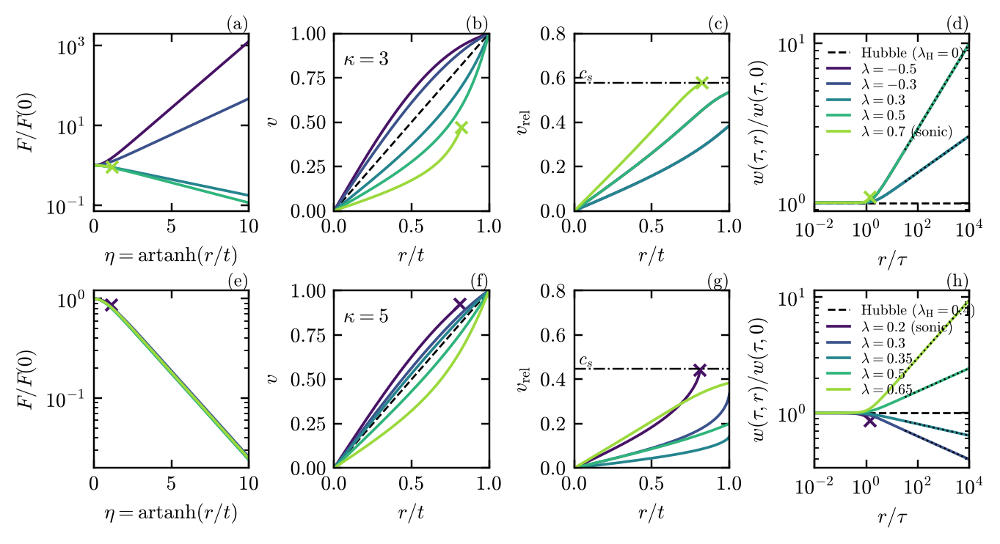
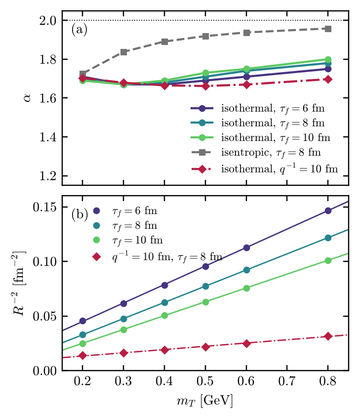

# LevyHydroSolutionCodes

Python codes accompanying the paper

> M. Csanád, M. Nagy, B. Szentkuti, Á. Benyó,
> *Accelerating exact solutions of relativistic hydrodynamics and Lévy-shaped freeze-out sources*,
> arXiv:XXXX.XXXXX

The repository contains the numerical integration of the self-similar **λ potential flows (λ-PF)**, the
source functions and Lévy fits of λ-PF and of the **dressed Gubser flow**, symbolic and numerical checks of
analytic results, and the scripts that produce all figures and the numerical tables of the paper.

## Requirements

Python 3 with NumPy, SciPy and Matplotlib; SymPy for the symbolic part of `checks.py`
(tested with Python 3.13, NumPy 2.x, SciPy 1.18, Matplotlib 3.11, SymPy 1.14).

```bash
pip install -r requirements.txt
```

## Contents

**Libraries**

| File | Contents |
|------|----------|
| `lambdaPF.py` | λ-PF in Milne form, Φ = τ<sup>λ</sup> G(η): field equation, integration of the regular branch from the centre (with detection of the sonic line), velocity, relative velocity, w = p<sup>1/(κ+1)</sup>, proper acceleration; analytic light-cone exponent δ |
| `lambdaPF_source.py` | λ-PF integrated independently with the first-order form of the field equation; source function on τ<sub>f</sub> with the fast-tail (Hubble-type), isothermal and isentropic dressings; local tail slopes; side-direction correlation function and Lévy fit |
| `gubser.py` | Gubser flow (velocity, pressure, proper acceleration), temperature of the isothermal and isentropic dressings, transverse source and side-direction Lévy fit, single-particle spectra and effective temperatures, Gaussian homogeneity lengths |
| `style.py` | Common plot style and output directories |

**Scripts**

| Script | Reproduces | Run time* |
|--------|------------|-----------|
| `checks.py` | λ-PF: light-cone exponent δ, outer acceleration, critical point s<sub>c</sub>, central coefficients F<sub>1</sub>, F<sub>2</sub>, agreement of the two integrations, Hubble limit for κ = 3 (0.417λ); λ = 0 and the Rindler atmosphere (symbolic, SymPy); Gubser flow: p ∝ r<sup>−16/3</sup> and r·a → 2 | seconds |
| `hubble_levy.py` | Hubble-type Lévy solution: local source slopes at 10, 20 and 100–300 fm; high-m<sub>T</sub> power law of the spectrum, −6β/(1+2β); local inverse slopes and T<sub>eff</sub> | seconds |
| `lambdaPF_window.py` | Numerical vs. analytic edges of the subsonic window for 3 ≤ κ ≤ 12 (λ<sub>±</sub>, λ<sub>c</sub>); window for κ = 3, 5; bounds on the core acceleration c | ~1.5 min |
| `lambdaPF_critical.py` | Node/focus type of the critical point and the node strips below the window; node entry vs. fold of the regular branch; F″/F at s<sub>c</sub>; continuation of the transonic solutions through the node to s → 1 | seconds |
| `companion.py` | Appendix: self-similar flows with power-law initial data (centre branch = λ-PF, the a<sub>p</sub> window, V = ξ and V = 1/ξ, tail branch); Rindler atmosphere (SymPy) | seconds |
| `fig_lambdaPF.py` | Figures: regular branch of λ-PF for κ = 3 and 5; fate of the regular branch in the (κ, λ) plane; proper acceleration | ~3 min |
| `fig_gubser_Tearly.py` | Figure: temperature of the dressed Gubser flow at early times | seconds |
| `gubser_levy_data.py`, `fig_gubser_levy.py` | Table and figure of the Lévy fits of the dressed Gubser flow (α and R<sup>−2</sup> vs. m<sub>T</sub>) | ~1.5 min |
| `tab_gubser_spectra.py` | Table of the q scan (v<sub>max</sub>, ⟨v<sub>⊥</sub>⟩, effective temperatures of π, K, p); α and R<sup>−2</sup> slope vs. q | ~0.5 min |
| `tab_gubser_radii.py` | Table of the Gaussian homogeneity lengths; exact-K<sub>1</sub> values and emission-time contribution to R<sub>out</sub><sup>2</sup> | seconds |
| `gubser_kaons.py` | Kaon vs. pion Lévy fits at equal m<sub>T</sub> (benchmark and q<sup>−1</sup> = 10 fm) | ~0.5 min |
| `gubser_fit_systematics.py` | Lévy-fit systematics: fit window, free intercept | ~0.5 min |
| `tab_lambdaPF_tails.py` | Numerical tail slopes of the λ-PF sources with the fast-tail dressing (values in parentheses in the table of the Lévy-stable range; the Hubble-type slopes) | seconds |
| `tab_lambdaPF_levy.py` | Table of the Lévy fits of λ-PF with the fast-tail dressing (r ≤ 300 fm and full source, share of S̃(0) from large r; κ = 3 case); fits with the isothermal and isentropic dressings | ~8 min |
| `run_all.py` | Runs everything and stores the printed output of each script in `results/` | ~20 min |

\*single core

Figures are written to `figures/` (PDF as used in the paper, plus a PNG preview), intermediate data to `figs/`.
All directories are created automatically. Each script describes its parameters and output in its docstring.

## Reproducing the paper

```bash
python run_all.py
```

or individual scripts, e.g.

```bash
python fig_lambdaPF.py                      # or select figures: profiles window accel
python gubser_levy_data.py && python fig_gubser_levy.py
python tab_lambdaPF_levy.py table           # or: step1
```

## Examples

**λ potential flows.** Regular branch for κ = 3 (top) and κ = 5 (bottom): potential, radial velocity,
velocity relative to the similarity lines, and w = p<sup>1/(κ+1)</sup> on τ = const. Crosses mark where the
branch reaches the sonic line.



**Dressed Gubser flow.** Lévy exponent α (top) and R<sup>−2</sup> (bottom) versus m<sub>T</sub> for pions,
from side-direction fits of the transverse source.



The images above illustrate the output of the code; the paper is the reference for all results.

## Using the libraries

```python
from lambdaPF import solve
sol = solve(lam=0.3, k=5)        # regular branch of lambda-PF for kappa = 5
print(sol['sonic'], sol['c'])    # False (reaches the light cone), core acceleration c = 1.17

import gubser as G
alpha, R = G.levy_fit_side(mT=0.4)[:2]          # benchmark q^-1 = 4.3 fm, tau_f = 8 fm, T_f = 140 MeV
print(alpha, R)                                 # side-direction Levy exponent and scale (fm)

import numpy as np
from lambdaPF_source import Source, side_corr, levy_fit
Qs = np.logspace(-3.8, -0.3, 350)               # GeV
src = Source(lam=0.3, k=5, beta=0.55)           # fast-tail dressing, R0 = 5 fm, tau_f = 8 fm
y = side_corr(src, mT=0.2, Qs=Qs, cuts=[300.0])
print(levy_fit(Qs, y[300.0]))                   # alpha, R for the source restricted to r <= 300 fm
```

## Citation

If you use these codes, please cite the paper above. The version of the code used for the paper is tagged
as `v1.0`.

## License

[to be added]
